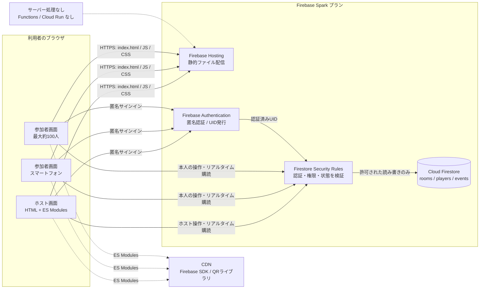
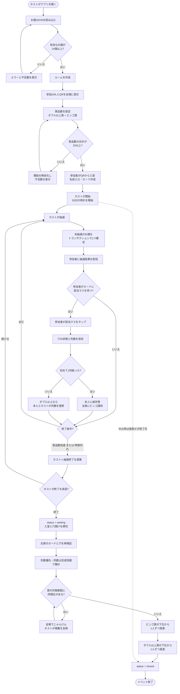
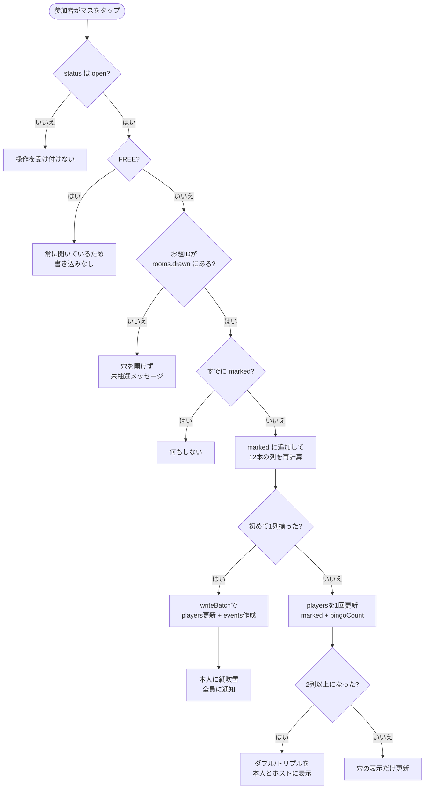
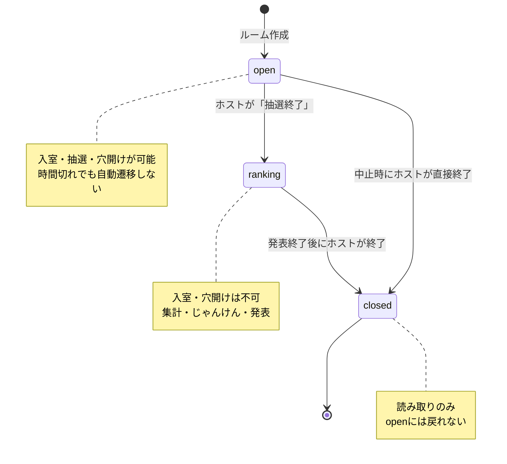

# Google Cloud ビンゴ 構成図・DFD・フローチャート

この文書は、`requirements.md` と `design.md` の内容を図で確認するための資料です。

> 現在のリポジトリは仕様・設計段階です。以下は、実装後に採用する構成を表しています。Cloud Functions / Cloud Run などのサーバー処理はありません。

## 1. インフラ構成図



### コンポーネントの役割

| コンポーネント | 役割 |
|---|---|
| Firebase Hosting | HTML、JavaScript、CSS、プレースホルダー画像などを静的配信 |
| Firebase Authentication | 匿名UIDを発行し、ホストと参加者を識別 |
| Cloud Firestore | ルーム、カード、穴の状態、ビンゴ通知、発表済み結果を保存・配信 |
| Firestore Security Rules | ホストだけがルームを更新できること、参加者が本人のデータだけを書けること、締切後に書けないことを保証 |
| ブラウザ | カード生成、ビンゴ判定、時間計算、ランキング集計、QR生成を実行 |
| CDN | バージョン固定したFirebase SDKとQR生成ライブラリを配信 |

## 2. DFD(データフロー図)

```mermaid
flowchart LR
  Host[外部実体: ホスト]
  Player[外部実体: 参加者]

  P1((1. 匿名認証・画面表示))
  P2((2. ルーム作成・進行))
  P3((3. 入室・カード管理))
  P4((4. 抽選・穴開け・ビンゴ判定))
  P5((5. ランキング集計・発表))

  Auth[(D1: Firebase Auth<br/>匿名UID)]
  Rooms[(D2: rooms/{roomId}<br/>お題・drawn・状態・時間・景品数・発表結果)]
  Players[(D3: players/{uid}<br/>名前・カード・marked・列数)]
  Events[(D4: events/{uid}<br/>初回ビンゴ通知)]
  Local[(D5: ホスト localStorage<br/>じゃんけん順)]

  Host -->|ページを開く| P1
  Player -->|QRのURLを開く| P1
  P1 -->|匿名サインイン| Auth
  Auth -->|UID| P1

  Host -->|お題JSON・時間配分・景品数・開始/終了操作| P2
  P2 -->|作成・更新| Rooms
  Rooms -->|状態・抽選結果・発表結果| P2
  P2 -->|QR・進行状況・抽選結果| Host

  Player -->|名前| P3
  P3 -->|カード作成・本人データ保存| Players
  Players -->|同じカード・穴の状態| P3
  P3 -->|カード画面| Player

  Host -->|抽選操作| P4
  P4 -->|トランザクションで drawn 更新| Rooms
  Rooms -->|抽選済みお題| P4
  Player -->|抽選済みマスをタップ| P4
  P4 -->|marked・bingoCount・bingoAt| Players
  P4 -->|初回ビンゴを1件だけ作成| Events
  Events -->|新規ビンゴ通知| P4
  P4 -->|穴の表示・ビンゴ通知| Player
  P4 -->|達成者一覧| Host

  Host -->|集計・じゃんけん結果・次を発表| P5
  Rooms -->|drawn・景品数| P5
  Players -->|全員のcard・marked| P5
  P5 <-->|同順位の並べ替え| Local
  P5 -->|発表した1人だけresultへ追加| Rooms
  Rooms -->|発表済み順位だけ配信| Player
  P5 -->|ランキング操作画面| Host
```

### 主なデータと公開範囲

| データ | 書く人 | 読める人 |
|---|---|---|
| `rooms/{roomId}` | ホストのみ | ルームIDを知る認証済みユーザー |
| `players/{uid}` | 本人のみ(`open`中) | 本人とホスト |
| `events/{uid}` | 本人が初回ビンゴ時に1回だけ | 認証済みユーザー |
| じゃんけん順 | ホスト端末のみ | ホスト端末のみ。Firestoreには保存しない |
| 未発表ランキング | Firestoreには保存しない | ホストのブラウザ内だけ |
| 発表済みランキング | ホストが1人ずつ `rooms.result` に追加 | 参加者を含む認証済みユーザー |

## 3. イベント全体のフローチャート



## 4. マスをタップした時のフローチャート



## 5. 状態遷移


